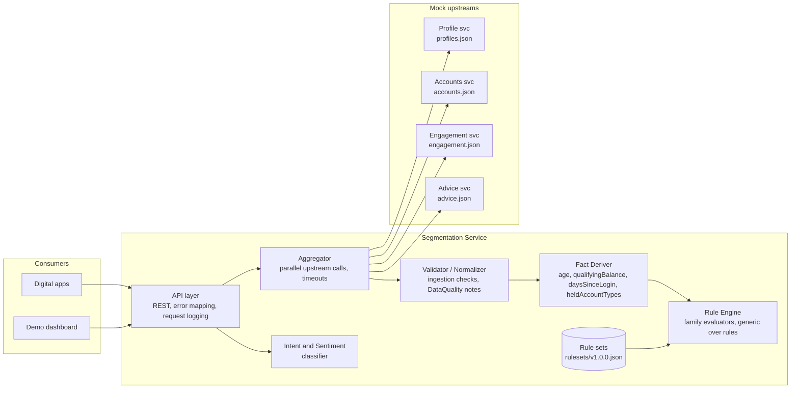

# Centralized Client Segmentation Service: Design Draft

> **Status:** Draft v0.1 for team review
> **Sources:** Customer Requirements Document (FR-01–FR-18, NFR-01–NFR-12), `01-intent-catalog.pdf`, `02-segmentation-groups.pdf`, `general-primary-service-requirements.md`, and the synthetic data in `data/`.
> **As-of date:** every evaluation uses `asOfDate = 2026-10-01` unless a caller overrides it explicitly (NFR-08).

---

## 1. Goals

The service gives each Vanguard digital experience one API call that answers "who is this client?" It replaces the per-application work of calling four upstream systems and running separate segmentation logic.

In scope:

1. **Segmentation API.** Takes a client ID and returns segments across five families (FR-01, FR-04 to FR-09).
2. **Aggregation.** Combines profile, accounts, engagement, and advice data from mock upstream services (FR-02, FR-14).
3. **Rules stored as data.** Rules live in a versioned rule-set file, separate from the evaluation engine (FR-03, FR-11, NFR-02, NFR-04).
4. **Explainable, reproducible results.** Each result carries the rule-set version, as-of date, derived facts, the rule that fired, and data-quality notes (FR-12, NFR-01, NFR-12).
5. **Intent and sentiment.** Classifies free-text client messages (FR-16, FR-17).
6. **Demo dashboard** (FR-18).

Out of scope: live Vanguard systems, real authentication, real data, investment advice, transactions, ML-based *segmentation*, and production deployment. ML may still be used for intent and sentiment classification, since that is a separate capability.

---

## 2. Architecture

An editable version of this diagram is in [`architecture.drawio`](architecture.drawio). Open it in diagrams.net or the VS Code Draw.io extension. It also shows the numbered retrieval path and the uniform response contract.



### 2.1 Modules (NFR-03)

| Module | Responsibility | Must not |
|---|---|---|
| **API layer** | HTTP routing, request validation, mapping domain errors to HTTP status codes, correlation IDs, logging | Contain segmentation logic |
| **Upstream clients / Aggregator** | Call the four mock services in parallel, apply timeouts, and turn "404 from upstream" into `missing` rather than an error | Interpret field values |
| **Validator / Normalizer** | Type and format checks, null detection, cross-field conflict detection; emits `DataQualityNote`s; parses money as `Decimal` | Assign segments |
| **Fact Deriver** | Computes derived facts from the normalized record and `asOfDate` | Know about segment names |
| **Rule Engine** | Loads a rule set, evaluates each family, enforces exclusivity, records traces | Hard-code thresholds or segment names |
| **Intent / Sentiment** | Classifies text and returns label, confidence, top-k, and an escalation flag | Read segmentation rules |

### 2.2 Request flow (`GET /v1/clients/{clientId}/segments`)

1. Validate `clientId` against the pattern `^C-\d{6}$`. Otherwise return **400**.
2. Call the profile service first. If no profile exists, return **404 `CLIENT_NOT_FOUND`**. The profile is the system of record for whether a client exists, so `C-999999`, which has only an engagement record, also returns 404.
3. Call accounts, engagement, and advice in parallel. A 404 from any of them means the record is missing, which is a data-quality condition and not an error.
4. Validate and normalize the records, then derive facts.
5. Evaluate every family in the active rule set, collecting traces and data-quality notes.
6. Return the result, stamped with `ruleSetVersion`, `asOfDate`, and `evaluatedAt`.

Handling upstream outages (timeouts, 5xx responses) is out of scope for this architecture draft.

---

## 3. Data contracts

### 3.1 Upstream (as supplied)

| Source | Key fields used | Notes from the data |
|---|---|---|
| Profiles (250) | `clientId`, `dateOfBirth` | One null DOB (`C-100197`). Youngest DOB is 2004-09-16 (age 22), so no client in the current data is under 22. |
| Accounts (542) | `accountType`, `ownerClientIds[]`, `status`, `balance` | 2 CLOSED accounts (both belong to `C-100081`). 3 `JOINT_BROKERAGE` accounts with two owners each. No null or negative balances today, but the validator must handle them. Holdings sum to balance on every account. |
| Engagement (250) | `lastLoginDate` | Orphan record `C-999999`. `C-100060` has no record. |
| Advice (249) | `adviceService`, `advisorId` | `C-100093` has no record. Values seen: `NONE`, `DIGITAL_ADVISOR`, `PERSONAL_ADVISOR`, `PERSONAL_ADVISOR_SELECT`, `PERSONAL_ADVISOR_WEALTH_MGMT`. |

Account types in the data: `INDIVIDUAL_BROKERAGE`, `401K`, `TRADITIONAL_IRA`, `ROTH_IRA`, `ROLLOVER_IRA`, `529`, `TRUST`, `JOINT_BROKERAGE`.

### 3.2 Derived facts

| Fact | Definition |
|---|---|
| `age` | Whole years at `asOfDate`. A birthday on the as-of date counts as already had (`C-100063`, born 1961-10-01, is 65). |
| `qualifyingBalance` | `Decimal` sum of `balance` over accounts where `status = OPEN` **and** `ownerClientIds[0] == clientId`. Null or negative balances are excluded with a note. |
| `openAccountCount`, `totalAccountCount` | Counts over every account the client appears in. |
| `heldOpenAccountTypes` | Set of `accountType` values for OPEN accounts where the client appears **anywhere** in `ownerClientIds`. |
| `daysSinceLogin` | `asOfDate - lastLoginDate` in days. |
| `adviceService` | Raw upstream value, passed through. |

### 3.3 Ingestion rejections

Per the segmentation-groups doc, a DOB that is not a valid date, or that makes the client **under 22**, is rejected at ingestion. The DOB is treated as absent and never reaches the rules, and the validator emits a `DataQualityNote` with severity `ERROR` and code `INVALID_DOB` or `UNDER_MINIMUM_AGE`. LIFE_STAGE then returns `OTHER`. This draft proposes `OTHER` with reason `INVALID_DOB` in this case, to keep it separate from `MISSING_DOB`. Confirm with the stakeholder.

---

## 4. Segmentation rules

### 4.1 Family semantics

| Family | Cardinality | When key data is missing |
|---|---|---|
| `SERVICE_TIER` | exactly one, or `OTHER` | `OTHER` + `NO_ACCOUNTS` / `NO_OPEN_ACCOUNTS` |
| `LIFE_STAGE` | exactly one, or `OTHER` | `OTHER` + `MISSING_DOB` |
| `ADVICE` | exactly one, or `OTHER` | `OTHER` + `MISSING_ADVICE_RECORD` / `UNMAPPED_ADVICE_VALUE` |
| `ENGAGEMENT` | zero or one, or `OTHER` | `OTHER` + `MISSING_ENGAGEMENT_RECORD`. 31–179 days gives **no segment** and is not an error. |
| `OPPORTUNITY` | zero or more | A rule whose input is missing is **not assigned** and gets a `NOT_EVALUATED` note. |

**Key-field rule:** each family reads only its key fields. A disagreement in a non-key field, such as age 29 with `employmentStatus = RETIRED`, produces a `WARNING` note and never changes a segment.

### 4.2 Rule-set format (draft `rulesets/v1.0.0.json`)

The engine supports a small number of **evaluator kinds**. Thresholds, mappings, segment names, and reason codes are all data. A new family that uses an existing kind needs only a config change (NFR-04). A new *kind* is the only change that requires code.

```json
{
  "ruleSetVersion": "1.0.0",
  "effectiveDate": "2026-10-01",
  "families": [
    {
      "family": "SERVICE_TIER",
      "kind": "THRESHOLD_BANDS",
      "exclusive": true,
      "input": "qualifyingBalance",
      "bands": [
        { "segment": "FLAGSHIP_SELECT", "min": "5000000.00" },
        { "segment": "FLAGSHIP",        "min": "1000000.00" },
        { "segment": "VOYAGER_SELECT",  "min": "500000.00" },
        { "segment": "VOYAGER",         "min": "50000.00" },
        { "segment": "STANDARD",        "min": "0.00" }
      ],
      "preconditions": [
        { "when": "totalAccountCount == 0", "other": "NO_ACCOUNTS" },
        { "when": "openAccountCount == 0",  "other": "NO_OPEN_ACCOUNTS" }
      ],
      "accountFilter": { "status": ["OPEN"], "ownership": "PRIMARY", "accountTypes": "ALL" }
    },
    {
      "family": "LIFE_STAGE",
      "kind": "THRESHOLD_BANDS",
      "exclusive": true,
      "input": "age",
      "bands": [
        { "segment": "RETIREE",      "min": 65 },
        { "segment": "PRE_RETIREE",  "min": 55 },
        { "segment": "MID_CAREER",   "min": 35 },
        { "segment": "EARLY_CAREER", "min": 22 }
      ],
      "preconditions": [{ "when": "age == null", "other": "MISSING_DOB" }]
    },
    {
      "family": "ADVICE",
      "kind": "VALUE_MAP",
      "exclusive": true,
      "input": "adviceService",
      "map": {
        "NONE": "SELF_DIRECTED",
        "DIGITAL_ADVISOR": "DIGITALLY_ADVISED",
        "PERSONAL_ADVISOR": "HUMAN_ADVISED",
        "PERSONAL_ADVISOR_SELECT": "HUMAN_ADVISED",
        "PERSONAL_ADVISOR_WEALTH_MGMT": "HUMAN_ADVISED"
      },
      "preconditions": [{ "when": "adviceRecord == null", "other": "MISSING_ADVICE_RECORD" }],
      "unmapped": { "other": "UNMAPPED_ADVICE_VALUE" }
    },
    {
      "family": "ENGAGEMENT",
      "kind": "RANGE_BANDS",
      "exclusive": true,
      "allowNone": true,
      "input": "daysSinceLogin",
      "bands": [
        { "segment": "DIGITALLY_ACTIVE", "max": 30 },
        { "segment": "DORMANT",          "min": 180 }
      ],
      "preconditions": [{ "when": "engagementRecord == null", "other": "MISSING_ENGAGEMENT_RECORD" }]
    },
    {
      "family": "OPPORTUNITY",
      "kind": "PREDICATES",
      "exclusive": false,
      "rules": [
        { "segment": "ROLLOVER_CANDIDATE",
          "all": [ { "fact": "age", "op": ">=", "value": 55 },
                   { "fact": "heldOpenAccountTypes", "op": "contains", "value": "401K" } ] },
        { "segment": "EDUCATION_SAVER",
          "all": [ { "fact": "heldOpenAccountTypes", "op": "contains", "value": "529" } ] },
        { "segment": "ADVICE_PROSPECT",
          "all": [ { "fact": "qualifyingBalance", "op": ">=", "value": "500000.00" },
                   { "family": "ADVICE", "op": "==", "value": "SELF_DIRECTED" } ] }
      ]
    }
  ]
}
```

Notes:

- `THRESHOLD_BANDS` are ordered highest first and the first match wins, which gives "highest threshold met wins".
- Money values are **strings** in config and parsed to `Decimal`, so no float ever touches a balance (NFR-11).
- A predicate that reads a null fact, or a family that resolved to `OTHER`, is **not evaluated**. The engine records `NOT_EVALUATED` and does not assign the segment.
- `OPPORTUNITY` can depend on `ADVICE`. The engine evaluates families in dependency order: exclusive families first, then predicates.
- Rule sets are immutable once published. A change means a new file with a new `ruleSetVersion`. On startup the service loads every rule set in `rulesets/` and validates each one against a JSON Schema. A rule set that fails validation stops the service from starting, so a broken rule set cannot serve traffic.

---

## 5. API

Base path `/v1`. Content type is JSON. Authentication is out of scope.

### 5.1 `GET /v1/clients/{clientId}/segments`

Query parameters, all optional:

| Param | Default | Purpose |
|---|---|---|
| `asOfDate` | `2026-10-01` (configured) | Explicit override for reproducibility testing |
| `ruleSetVersion` | active version | Evaluate against a specific published rule set |
| `families` | all | Comma-separated filter, for example `SERVICE_TIER,OPPORTUNITY`. It controls what is **returned**, not what is computed: dependencies such as `ADVICE` for `ADVICE_PROSPECT` are still evaluated, so filtered and unfiltered results always agree. |
| `explain` | `false` | Adds the derived `facts` and a `trace` per family |

#### Uniform family result (decided)

Every family returns the **same shape**, whether it is exclusive or not. A consumer never needs to know a family's cardinality to parse it, and a new family added through config appears in the response without an API change (NFR-04).

```
FamilyResult {
  status:  "ASSIGNED" | "NONE" | "OTHER"
  values:  string[]        // exclusive families: 0 or 1 item; overlapping families: 0..n items
  reason?: string          // present only when status == "OTHER"
  trace?:  Trace           // present only when explain=true
}
```

| `status` | Meaning | `values` | Example |
|---|---|---|---|
| `ASSIGNED` | One or more segments matched | non-empty | `["FLAGSHIP"]`, `["ROLLOVER_CANDIDATE", "EDUCATION_SAVER"]` |
| `NONE` | Key data present, no segment applies (not an error) | `[]` | ENGAGEMENT at 31–179 days, OPPORTUNITY with no matches |
| `OTHER` | Key data missing or unmapped | `[]` | LIFE_STAGE with `reason: "MISSING_DOB"` |

Consumers check membership the same way for every family: `"FLAGSHIP" in segments.SERVICE_TIER.values`. A dedicated `OTHER` status, instead of putting `"OTHER"` in `values`, means a membership check can never match `OTHER` by accident. `values` is sorted in rule-set order so output is deterministic (NFR-01).

Family metadata such as `exclusive` and `allowNone` is not in the segment response. Consumers that want it can read it from `GET /v1/rulesets/{version}`, but they don't need it to read results.

**200 response** (example: `C-100197`, missing DOB):

```json
{
  "clientId": "C-100197",
  "asOfDate": "2026-10-01",
  "ruleSetVersion": "1.0.0",
  "evaluatedAt": "2026-11-04T15:02:11Z",
  "segments": {
    "SERVICE_TIER": { "status": "ASSIGNED", "values": ["STANDARD"] },
    "LIFE_STAGE":   { "status": "OTHER",    "values": [], "reason": "MISSING_DOB" },
    "ADVICE":       { "status": "ASSIGNED", "values": ["DIGITALLY_ADVISED"] },
    "ENGAGEMENT":   { "status": "ASSIGNED", "values": ["DIGITALLY_ACTIVE"] },
    "OPPORTUNITY":  { "status": "ASSIGNED", "values": ["EDUCATION_SAVER"] }
  },
  "signals": {
    "daysSinceLogin": 22
  },
  "dataQuality": [
    { "severity": "WARNING", "code": "MISSING_FIELD", "source": "profile", "field": "dateOfBirth" },
    { "severity": "INFO", "code": "NOT_EVALUATED", "family": "OPPORTUNITY",
      "segment": "ROLLOVER_CANDIDATE", "message": "age unavailable" }
  ]
}
```

**What is returned by default and what is opt-in:**

| Block | Default | Why |
|---|---|---|
| `clientId`, `asOfDate`, `ruleSetVersion`, `evaluatedAt` | always | Result metadata (FR-12); with the inputs, it makes any result reproducible |
| `segments` | always | The answer |
| `signals` | always | Non-segment values consumers are told to use. `daysSinceLogin` is required even when ENGAGEMENT is `NONE`. |
| `dataQuality` | always | Lets consumers tell a real `NONE` from degraded data |
| `facts` | `explain=true` | Age, qualifying balance, held account types. Kept out by default so apps that only need segments don't receive financial details. |
| `trace` per family | `explain=true` | Which rule fired, on what value, and which accounts counted (NFR-12) |

With `explain=true`, the response adds:

```json
"facts": {
  "age": null,
  "qualifyingBalance": "12400.48",
  "heldOpenAccountTypes": ["529", "..."]
},
"segments": {
  "SERVICE_TIER": {
    "status": "ASSIGNED", "values": ["STANDARD"],
    "trace": { "ruleId": "SERVICE_TIER.bands[4]", "input": "qualifyingBalance",
               "value": "12400.48", "matched": { "segment": "STANDARD", "min": "0.00" },
               "contributingAccounts": ["A-…"] }
  }
}
```

The batch endpoint returns the same per-client object: `{ "results": [ <response> | { "clientId", "error" } ] }`.

### 5.2 Other endpoints

| Method and path | Purpose |
|---|---|
| `POST /v1/segments:batch` | Body `{ "clientIds": [...] }`, up to 100 IDs. Returns per-client results or errors. Used by the dashboard. |
| `GET /v1/rulesets` | List published rule-set versions and mark the active one |
| `GET /v1/rulesets/{version}` | Return the rule-set document so business analysts can review it |
| `POST /v1/interactions:classify` | Body `{ "text": "...", "clientId"?: "..." }`. Returns intent and sentiment (§7). |
| `GET /health`, `GET /ready` | Liveness, and readiness (rule sets loaded, upstreams reachable) |

### 5.3 Errors (FR-13)

Every error uses one envelope: `{ "error": { "code", "message", "correlationId", "details"? } }`.

| HTTP | `code` | When |
|---|---|---|
| 400 | `INVALID_CLIENT_ID` / `INVALID_PARAMETER` | Malformed ID, a bad `asOfDate`, or an unknown family |
| 404 | `CLIENT_NOT_FOUND` | No profile record (`C-000000`, `C-999999`) |
| 404 | `RULESET_NOT_FOUND` | Unknown `ruleSetVersion` |
| 500 | `INTERNAL_ERROR` | Anything unexpected. It is logged with the correlation ID and never leaks a stack trace. |

---

## 6. Data-handling policies (FR-10, open questions)

| # | Question | Proposed policy | Source |
|---|---|---|---|
| 1 | Compute on request or precompute? | **Decided: compute on request for v1.** The data is small (250 clients), evaluation is pure and fast, and results can never go stale. **Future option: precompute.** The engine is a pure function, so a later precompute job (on data change or on a schedule) can reuse it unchanged and store results keyed by `(clientId, ruleSetVersion, asOfDate)`. The API would then read from that store and fall back to computing on request. Don't build anything for this yet; just keep the engine free of I/O so the option stays open. | Team decision |
| 2 | Conflicting sources | Key-field rule: segment only on the key field, and emit a `WARNING` for the conflict. `C-100233` stays `EARLY_CAREER` with a `CONFLICTING_DATA` warning. `C-100085` stays `SELF_DIRECTED` with an `advisorId` warning. | Segmentation-groups doc |
| 3 | Joint accounts | **Tier:** the full balance counts toward `ownerClientIds[0]` and $0 toward the secondary owner. **Opportunity:** either owner holds the account. | Segmentation-groups doc |
| 4 | Version results? | **Yes.** Every result carries `ruleSetVersion` and `asOfDate`. The same inputs always give the same output (NFR-01). | FR-12 |
| 5 | Stack | Open for the team (§9) | n/a |
| 6 | Client under 22 or invalid DOB | Reject the DOB at ingestion. LIFE_STAGE returns `OTHER`, with `INVALID_DOB` proposed as the reason. The other families still evaluate. | Doc plus proposal |
| 7 | Null or negative balance | Exclude the account from `qualifyingBalance` and emit a `WARNING`. The account still counts as open for `NO_OPEN_ACCOUNTS`. | Doc |
| 8 | Missing upstream record | Not an error. The affected family returns `OTHER` with a reason, and opportunities that depend on it are `NOT_EVALUATED`. | Doc |

`DataQualityNote` = `{ severity: INFO|WARNING|ERROR, code, source?, field?, family?, segment?, message }`.

---

## 7. Intent classification and sentiment (FR-16, FR-17)

**Intent:** 45 labels from the intent catalog plus `UNKNOWN`.

**Output:**

```json
{
  "intent": { "label": "ROLLOVER_HELP", "confidence": 0.81,
              "topK": [ {"label":"ROLLOVER_HELP","confidence":0.81},
                        {"label":"EDUCATION_SAVINGS","confidence":0.12},
                        {"label":"OPEN_ACCOUNT","confidence":0.03} ] },
  "sentiment": { "label": "NEUTRAL", "confidence": 0.77, "escalationSuggested": false },
  "classifierVersion": "intent-0.1.0"
}
```

**Proposed approach.** Treat the classifier as a pluggable `Classifier` interface so the team can swap implementations without touching the API.

1. **Baseline:** TF-IDF on character and word n-grams, with logistic regression trained on the catalog examples plus team-written paraphrases. It handles typos well and is cheap and deterministic.
2. **Optional upgrade:** an LLM or embedding classifier behind the same interface, compared against the baseline on the hard-case set.

**Thresholds and rules:**

- If top-1 confidence is below a configurable threshold, starting at 0.45, return `UNKNOWN` but still include `topK`. This covers vague requests like "move my money".
- **Documented choice for off-topic financial questions:** "should I buy bitcoin" maps to `ADVICE_INTEREST`, because the client is asking for investment guidance.
- Negation: "don't close my account, just the joint one" maps to `CLOSE_ACCOUNT`. Negation changes the scope of the request, not the label.
- `escalationSuggested = true` when any of these holds:
  - sentiment is `NEGATIVE` with confidence ≥ 0.7
  - intent is `TALK_TO_HUMAN`, `COMPLAINT`, `FRAUD_REPORT`, or `REPORT_DEATH`
  - the text contains repeated-contact markers such as "third time"

  These thresholds live in config, not code.
- **Segment-aware routing (optional):** when a `clientId` is passed, attach segments so the consumer can, for example, send `ADVICE_INTEREST` from an `ADVICE_PROSPECT` to an advisor.

**Evaluation set.** Every catalog example, plus the six hard-case categories from the catalog. Report accuracy, macro-F1, top-3 accuracy, and the confusion between `ROLLOVER_HELP`, `ACCOUNT_TRANSFER`, and `WITHDRAWAL`.

---

## 8. Testing (FR-15, NFR-07)

| Layer | What |
|---|---|
| Unit | Fact deriver (birthday on the as-of date, leap-year DOBs, Decimal sums), each evaluator kind, rule-set schema validation |
| Rule tests | Table-driven: synthetic fact input produces an expected segment, at every band edge (49,999.99 / 50,000.00, age 21/22/34/35/54/55/64/65, days 30/31/179/180) |
| Golden / oracle | Expected output for every client in `edge-cases.json` (below), plus a snapshot of all 250 clients under rule set 1.0.0 |
| Integration | API against the mock upstreams running in docker-compose |
| Contract | OpenAPI spec checked in, with responses validated against it |
| E2E | The dashboard loads a client, shows segments, and classifies a message |

### 8.1 Edge-case oracle (rule set 1.0.0, as-of 2026-10-01)

These values were computed from the supplied data with the rules above. Use them as the first golden tests.

| Client | Case | Tier (qualifying $) | Life stage | Advice | Engagement | Opportunities |
|---|---|---|---|---|---|---|
| C-100250 | $1 under $50K | STANDARD (49,999.99) | MID_CAREER | SELF_DIRECTED | DORMANT | EDUCATION_SAVER |
| C-100020 | exactly $50K | VOYAGER (50,000.00) | MID_CAREER | SELF_DIRECTED | DORMANT | EDUCATION_SAVER |
| C-100130 | $1 under $500K | VOYAGER (499,999.99) | EARLY_CAREER | SELF_DIRECTED | DORMANT | none |
| C-100144 | exactly $500K | VOYAGER_SELECT (500,000.00) | RETIREE | SELF_DIRECTED | DIGITALLY_ACTIVE | ADVICE_PROSPECT |
| C-100091 | $1 under $1M | VOYAGER_SELECT (999,999.99) | EARLY_CAREER | SELF_DIRECTED | DIGITALLY_ACTIVE | ADVICE_PROSPECT |
| C-100021 | exactly $1M | FLAGSHIP (1,000,000.00) | RETIREE | SELF_DIRECTED | DORMANT | ADVICE_PROSPECT |
| C-100228 | $1 under $5M | FLAGSHIP (4,999,999.99) | MID_CAREER | HUMAN_ADVISED | DIGITALLY_ACTIVE | EDUCATION_SAVER |
| C-100105 | exactly $5M | FLAGSHIP_SELECT (5,000,000.00) | MID_CAREER | SELF_DIRECTED | DIGITALLY_ACTIVE | ADVICE_PROSPECT |
| C-100188 | joint primary (A-10000542) | FLAGSHIP (1,880,639.84) | PRE_RETIREE | SELF_DIRECTED | DORMANT | ADVICE_PROSPECT |
| C-100114 | joint secondary | VOYAGER (102,956.64) | PRE_RETIREE | HUMAN_ADVISED | DIGITALLY_ACTIVE | ROLLOVER_CANDIDATE, EDUCATION_SAVER |
| C-100062 | joint primary (A-10000543) | FLAGSHIP (4,089,543.35) | RETIREE | SELF_DIRECTED | DIGITALLY_ACTIVE | ADVICE_PROSPECT |
| C-100178 | joint secondary | VOYAGER (315,426.05) | EARLY_CAREER | SELF_DIRECTED | DIGITALLY_ACTIVE | none |
| C-100030 | joint primary (A-10000544) | VOYAGER (264,906.06) | MID_CAREER | SELF_DIRECTED | DORMANT | EDUCATION_SAVER |
| C-100192 | joint secondary | STANDARD (2,155.83) | PRE_RETIREE | SELF_DIRECTED | DIGITALLY_ACTIVE | ROLLOVER_CANDIDATE |
| C-100081 | all accounts closed | OTHER / NO_OPEN_ACCOUNTS | PRE_RETIREE | HUMAN_ADVISED | DIGITALLY_ACTIVE | none (closed 401K does not count) |
| C-100117 | no accounts | OTHER / NO_ACCOUNTS | MID_CAREER | SELF_DIRECTED | DIGITALLY_ACTIVE | none |
| C-100060 | no engagement record | FLAGSHIP (2,771,006.52) | RETIREE | SELF_DIRECTED | OTHER / MISSING_ENGAGEMENT_RECORD | ADVICE_PROSPECT |
| C-100093 | no advice record | VOYAGER (81,244.88) | MID_CAREER | OTHER / MISSING_ADVICE_RECORD | DIGITALLY_ACTIVE | none, plus ADVICE_PROSPECT NOT_EVALUATED |
| C-100197 | null DOB | STANDARD (12,400.48) | OTHER / MISSING_DOB | DIGITALLY_ADVISED | DIGITALLY_ACTIVE | EDUCATION_SAVER, plus ROLLOVER_CANDIDATE NOT_EVALUATED |
| C-100247 | null state | VOYAGER (65,416.76) | EARLY_CAREER | SELF_DIRECTED | DIGITALLY_ACTIVE | none (state is not a key field, so INFO note only) |
| C-100233 | age 29 + RETIRED | VOYAGER (55,372.90) | EARLY_CAREER + WARNING | DIGITALLY_ADVISED | DIGITALLY_ACTIVE | none |
| C-100085 | NONE + advisorId | STANDARD (2,287.24) | MID_CAREER | SELF_DIRECTED + WARNING | DIGITALLY_ACTIVE | none |
| C-100063 | turns 65 on as-of date | VOYAGER_SELECT (932,076.44) | RETIREE | DIGITALLY_ADVISED | DIGITALLY_ACTIVE | EDUCATION_SAVER |
| C-999999 | orphan engagement | **404 CLIENT_NOT_FOUND** | | | | |
| C-000000 | unknown | **404 CLIENT_NOT_FOUND** | | | | |

**Population sanity check, all 250 clients:**

- Tiers: STANDARD 113, VOYAGER 65, VOYAGER_SELECT 16, FLAGSHIP 37, FLAGSHIP_SELECT 17, OTHER 2
- Life stages: EARLY 67, MID 70, PRE_RETIREE 56, RETIREE 56, OTHER 1
- Advice: SELF 153, DIGITAL 39, HUMAN 57, OTHER 1
- Engagement: ACTIVE 174, DORMANT 70, none 5, OTHER 1
- Opportunities: ROLLOVER 38, EDUCATION 35, ADVICE_PROSPECT 28

---

## 9. Non-functional plan

| NFR | How |
|---|---|
| 01 Consistency | The engine is a pure function of (normalized data, rule set, asOfDate), with no wall-clock reads inside it. Golden tests enforce this. |
| 02, 04 Maintainability and extensibility | Rules are data. Adding a family that uses an existing evaluator kind needs zero code changes. |
| 03 Modularity | The modules in §2.1 are separate packages with interfaces between them, so rules can be unit-tested without HTTP. |
| 05 Reliability | The validator turns every malformed input into a note. Upstream calls have timeouts. A fuzz test runs over randomized records. |
| 06 Performance | Proposed target: p95 < 200 ms for a single client against local mocks. Final targets will be set in evaluation planning. |
| 08 Reproducibility | `asOfDate` comes from config (default 2026-10-01) and can be overridden per request. |
| 09 Observability | Structured JSON logs with a correlation ID, upstream latency per source, rule-set version, and counts of data-quality notes. |
| 10 Portability | One Dockerfile per service. `docker-compose up` starts the CSS, four mock upstreams, and the dashboard. |
| 11 Data integrity | `Decimal` throughout. Balances are serialized as strings in JSON. |
| 12 Explainability | `explain=true` trace, plus the list of contributing account IDs. |

**Stack (proposal, for the team to decide).** The proposal is Python 3.12 with FastAPI and Pydantic for the CSS and the mock upstreams. Python has native `Decimal`, auto-generates an OpenAPI spec, and keeps the intent classifier in the same language as scikit-learn. The dashboard would use React with Vite, everything is orchestrated with docker-compose, and tests run on pytest. One alternative is Java with Spring Boot plus a Python sidecar for NLP. The other is TypeScript with NestJS, which would need decimal.js for money math.

---

## 10. Demo dashboard (FR-18)

- **Client lookup:** pick or search a client and see segment cards per family, `OTHER` reasons, data-quality notes, and an expandable trace.
- **Edge-case gallery:** one click per `edge-cases.json` record, showing expected and actual results side by side.
- **Rule-set switcher:** evaluate the same client under v1.0.0 and a demo v1.1.0 (for example, a changed VOYAGER threshold) to show that a rule change is a config change.
- **What-if:** override `asOfDate` and watch life stage and engagement change.
- **Message console:** type a client message and see intent top-3, sentiment, and the escalation flag. When the message is tied to a client, show that client's segments next to the result.
- **Population view:** counts per segment across all 250 clients.

---

## 11. Proposed repo layout

```
vanguard-css/
├── services/
│   ├── segmentation/        # CSS: api/, aggregation/, validation/, facts/, engine/, nlp/
│   └── mock-upstreams/      # serves data/*.json as profile/accounts/engagement/advice APIs
├── rulesets/
│   ├── schema.json
│   └── v1.0.0.json
├── dashboard/
├── tests/
│   ├── golden/edge-cases.expected.json
│   └── intent/eval-set.jsonl
├── data/                    # supplied synthetic data (read-only)
├── docs/
└── docker-compose.yml
```

## 12. Milestones (suggested)

1. Mock upstreams, aggregator, validator, and fact deriver, with unit tests.
2. Rule engine with rule set v1.0.0, then get the edge-case golden tests passing.
3. API, error model, OpenAPI spec, docker-compose.
4. Intent and sentiment baseline, plus the evaluation set and its metrics.
5. Dashboard, demo rule set v1.1.0, observability polish.

## 13. Open items for the stakeholder

1. Should the `OTHER` reason for a rejected or under-22 DOB be `INVALID_DOB`, or should it fold into `MISSING_DOB`?
2. When is the "formula replaces all-account-types" tier rule expected? The `accountFilter` config is ready for it.
3. What response-time targets apply (NFR-06)?
4. Is an LLM-based intent classifier acceptable for the demo, or should it stay deterministic and local?
