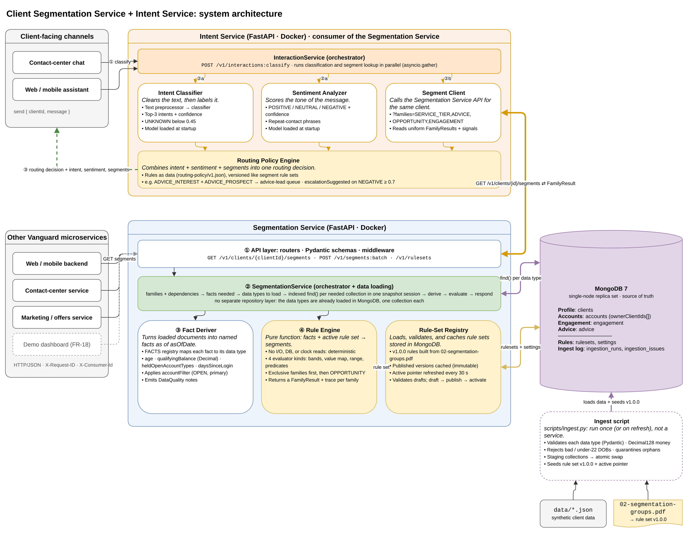
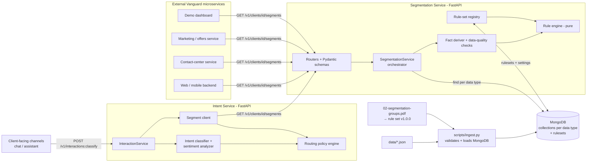
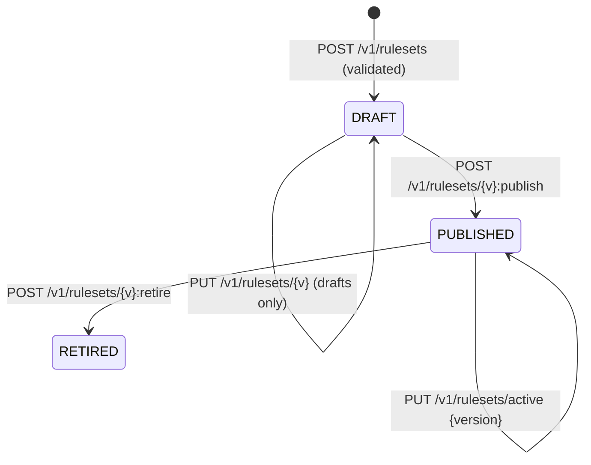
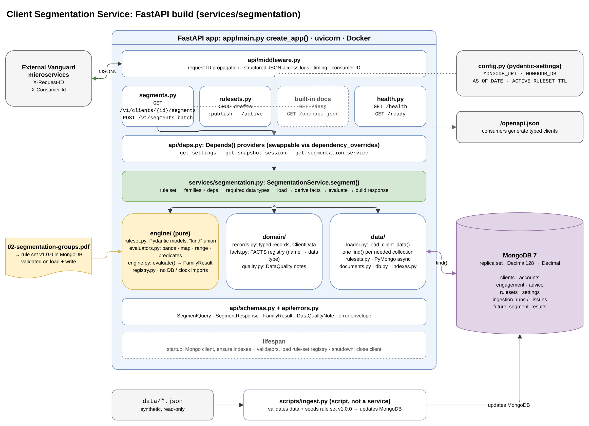
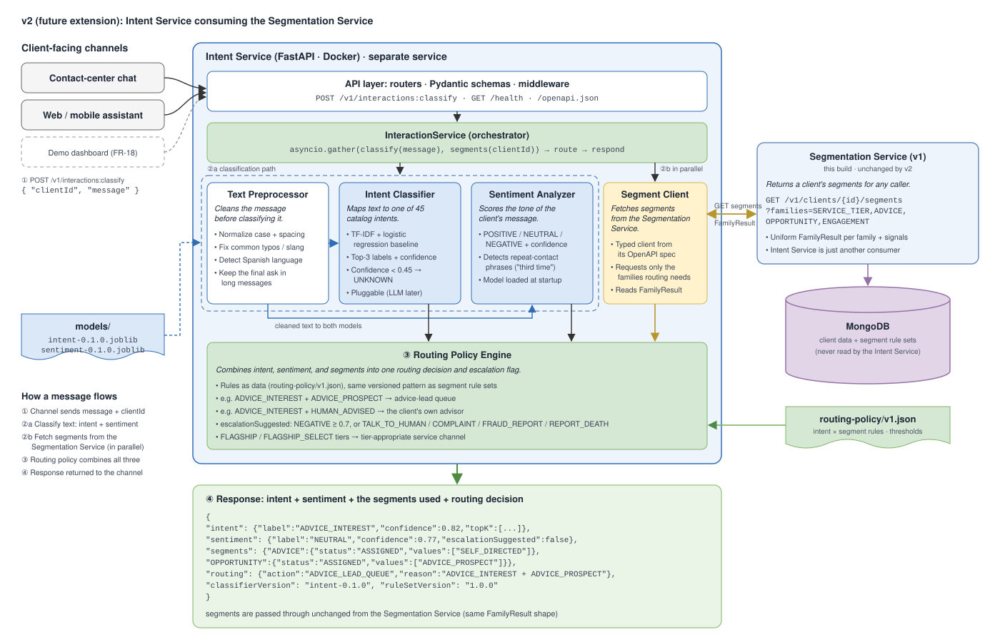
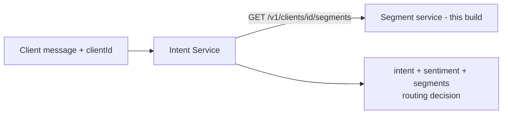

# Centralized Client Segmentation Service: Design Draft

> **Status:** Draft v0.4 for team review (revised after stakeholder feedback: repositories layer removed, rule set v1.0.0 built from `02-segmentation-groups.pdf`, Intent Service wired into the architecture, ingestion is a script)
> **Sources:** Customer Requirements Document (FR-01–FR-18, NFR-01–NFR-12), `01-intent-catalog.pdf`, `02-segmentation-groups.pdf`, `general-primary-service-requirements.md`, and the synthetic data in `data/`.
> **As-of date:** every evaluation uses `asOfDate = 2026-10-01` unless a caller overrides it explicitly (NFR-08).

### Decisions so far

| Decision | Choice |
|---|---|
| Scope | **Segments first, then intent.** Another service calls this service with a client ID and gets that client's segments back. The **Intent Service** is part of the architecture and consumes the segment API (§9); it is built after the segment API is stable. |
| Framework | **FastAPI** (Python 3.12, Pydantic v2). Reasons are in §6.0. |
| Who calls the service | **External Vanguard microservices**, over a versioned REST API |
| Client data | Four **data types** (profile, accounts, engagement, advice) stored by the service |
| Database | **MongoDB 7**, the only database. Chosen for flexibility in client fields and rule sets (§4). |
| Rule sets | Versioned documents in MongoDB, created and activated through the API without a redeploy (§5.4). v1.0.0 is built directly from `02-segmentation-groups.pdf`. |
| Data access | **No repository layer.** The data types are already loaded in MongoDB, one collection each, so the SegmentationService runs one indexed `find()` per needed collection itself (§3.3). |
| Ingestion | A **script** (`scripts/ingest.py`), run once or on refresh, not a running service (§3.5) |
| When segments are computed | **On request.** Precompute is a possible later addition. |
| Response shape | A **uniform `FamilyResult`** for every family (§7) |
| Upstream-outage handling | Out of scope for this draft |

---

## 1. Goals

The core use case is one call between services. A Vanguard microservice sends a client ID and gets that client's segments back. It never reads client data or runs segmentation logic itself.

- **One API** returns segments for a client. The five families in `02-segmentation-groups.pdf` (service tier, life stage, advice, engagement, opportunity) are the **starter examples** (FR-01, FR-04 to FR-09). The service is built so that more segments can be defined over any client data it stores (§5.3).
- **One store of client data**, organized by data type, holds what segmentation reads (FR-02, FR-14).
- **Rules are data.** They live in versioned rule-set documents that are separate from the evaluation engine and can be created without code changes (FR-03, FR-11, NFR-02, NFR-04).
- **Results are explainable and reproducible.** Each one carries the rule-set version, the as-of date, an optional trace, and data-quality notes (FR-12, NFR-01, NFR-12).
- **A demo dashboard** (FR-18), which calls the segment API like any other consumer.
- **Intent Service:** intent and sentiment classification (FR-16, FR-17), wired into the architecture as a consumer of segments (§9). The segment service is built first, because intent depends on it.

Out of scope: live Vanguard systems, real authentication, real data, investment advice, transactions, and ML-based *segmentation*.

---

## 2. Architecture



Editable source: [`architecture.drawio`](architecture.drawio). Page 1 shows the full system: the Intent Service, the Segmentation Service, MongoDB, and the ingest script. Page 2 shows the FastAPI build. Re-export the PNGs with draw.io (File → Export as → PNG) after editing.



### 2.1 Components (NFR-03)

**API layer.** The FastAPI routers, Pydantic schemas, and middleware that every consumer call goes through.
- Routes `/v1/clients/{clientId}/segments`, `/v1/segments:batch`, and `/v1/rulesets`
- Validates requests and responses against the published OpenAPI contract
- Maps errors to one envelope, propagates `X-Request-ID`, and writes JSON access logs
- Contains no segmentation logic

**SegmentationService.** The orchestrator that runs one segment request from start to finish, including loading the client's data.
- Resolves the requested families plus their dependencies (for example, `OPPORTUNITY` needs `ADVICE`)
- Works out which data types to load from the facts those families read
- Loads them straight from MongoDB with `load_client_data()`: one indexed `find()` per needed collection (`_id`, or the multikey `ownerClientIds` index), all in one snapshot session per request
- Uses projections, so personal details never leave the database on the segment path
- Then calls the fact deriver and the rule engine, and builds the response. It never applies thresholds itself: business rules such as "OPEN accounts only" belong to the fact deriver.

There is **no separate repository layer.** An earlier draft had one repository class per data type, but the data types are already loaded in MongoDB as one collection each, so a per-type wrapper added nothing over a single loader function.

**Fact Deriver.** The step that turns loaded documents into named facts as of the request's `asOfDate`.
- The `FACTS` registry maps each fact name to its data type and derivation function
- Computes `age`, `qualifyingBalance` (`Decimal`), `heldOpenAccountTypes`, `daysSinceLogin`, and more
- Applies the rule set's `accountFilter` (OPEN accounts, primary owner)
- Emits `DataQualityNote`s for missing documents, null fields, and cross-field conflicts
- Knows nothing about segment names

**Rule Engine.** A pure function that turns facts into segments using the active rule set.
- No I/O, database, or clock reads: the same inputs always give the same output (NFR-01)
- Four evaluator kinds: `THRESHOLD_BANDS`, `VALUE_MAP`, `RANGE_BANDS`, `PREDICATES`
- Evaluates exclusive families first, then `OPPORTUNITY`, in dependency order
- Returns a uniform `FamilyResult` per family, plus a trace when `explain=true`
- Has no hard-coded thresholds or segment names

**Rule-Set Registry.** The component that loads, validates, and caches rule-set documents stored in MongoDB.
- Rule set v1.0.0 is built directly from `02-segmentation-groups.pdf` (§5.2) and seeded into MongoDB by the ingest script. MongoDB is the source of truth from then on.
- Reads the `rulesets` and `settings` (active pointer) collections in MongoDB
- Caches published versions in memory indefinitely, since they are immutable
- Re-reads the active pointer at most every 30 seconds, so activation spreads to all workers
- Validates drafts on create and update (evaluator kinds, known facts, family dependencies)
- Serves the draft → publish → activate lifecycle (§5.4)
- Hands the engine a rule set but never evaluates rules itself

**Ingest script.** `scripts/ingest.py`, a script (not a service) that loads and refreshes client data and the v1.0.0 rule set in MongoDB.
- Validates each data type in `data/*.json` with its Pydantic model
- Stores money as `Decimal128`, rejects invalid or under-22 DOBs, and quarantines orphan records
- Loads into staging collections and then swaps them in atomically, so readers never see a half-loaded data set
- Seeds rule set v1.0.0 (from `02-segmentation-groups.pdf`) into the `rulesets` collection and records each run in `ingestion_runs`
- Run by hand (`python scripts/ingest.py data/`) or as a one-off `docker compose run`, never on the request path

**Intent Service.** A separate FastAPI service that classifies client messages (intent + sentiment) and calls the segment API for the same client to decide routing (§9).
- `InteractionService` runs classification and the segment lookup in parallel, then the Routing Policy Engine combines them
- Never reads client collections or rule sets directly. It is just another consumer of the segment API.

---

## 3. Client data types and how segments are retrieved from them

The four data types are four *views* of the same client, not four services. Each one is stored in its own MongoDB collection, owned by this service, and read with one indexed query. Segmentation works out which data types a request needs, loads only those, turns them into facts, and evaluates rules over the facts.

### 3.1 Data-type catalog

| Data type | Collection | Fields segmentation reads | Families it feeds | When the client has no document |
|---|---|---|---|---|
| **Profile** | `clients` | `dateOfBirth`, `dobStatus`. Read for quality checks only: `employmentStatus`, `state` | `LIFE_STAGE`, `OPPORTUNITY.ROLLOVER_CANDIDATE`. Also the **existence check**. | **404 `CLIENT_NOT_FOUND`**. The profile is the system of record for whether a client exists. |
| **Accounts** | `accounts` | `accountType`, `status`, `balance`, `ownerClientIds` | `SERVICE_TIER`, `OPPORTUNITY` (all three rules) | `SERVICE_TIER` → `OTHER` / `NO_ACCOUNTS`. Account-based opportunities are not assigned. |
| **Engagement** | `engagement` | `lastLoginDate` | `ENGAGEMENT`, `signals.daysSinceLogin` | `ENGAGEMENT` → `OTHER` / `MISSING_ENGAGEMENT_RECORD`, and `daysSinceLogin` is `null` |
| **Advice** | `advice` | `adviceService`. Read for a quality check only: `advisorId` | `ADVICE`, `OPPORTUNITY.ADVICE_PROSPECT` | `ADVICE` → `OTHER` / `MISSING_ADVICE_RECORD`. `ADVICE_PROSPECT` is `NOT_EVALUATED`. |

Other fields, such as `preferredChannel`, `clientSince`, `mobileAppUser`, `riskTolerance`, and `goals`, are stored but not read by the starter rule set. They become segment inputs as soon as a fact exposes them (§5.3). Personal details (names, email, phone) and holdings are never used for segmentation.

### 3.2 Facts: the link between data types and rules

Rules never read collections or raw documents. They read **facts**. Each fact is defined once in code, with the data type it comes from. These are the facts the starter rule set needs; §5.3 lists candidates to add.

| Fact | Data type | Derivation (as of `asOfDate`) |
|---|---|---|
| `dobStatus` | profile | `VALID`, `MISSING`, or `REJECTED` (set at ingestion, §3.5) |
| `age` | profile | Whole years. A birthday on the as-of date counts as already had. `null` unless `dobStatus = VALID`. |
| `totalAccountCount` / `openAccountCount` | accounts | Counts over every account the client appears on |
| `qualifyingBalance` | accounts | `Decimal` sum of `balance` where `status = OPEN` **and** `ownerClientIds[0] == clientId` (primary owner). Null or negative balances are excluded with a note. The filter comes from the rule set's `accountFilter`. |
| `heldOpenAccountTypes` | accounts | Set of `accountType` over OPEN accounts where the client appears **anywhere** in `ownerClientIds` |
| `adviceRecordPresent` / `adviceService` | advice | Presence flag and the raw upstream value |
| `engagementRecordPresent` / `daysSinceLogin` | engagement | Presence flag and `asOfDate - lastLoginDate` in days |

The rule set refers to facts by name, so the engine can work out the **data types a request needs**. For example, a request for `SERVICE_TIER` only reads `totalAccountCount`, `openAccountCount`, and `qualifyingBalance`, so it loads profile and accounts and nothing else. A new family built from existing facts needs no code change. A new fact requires one entry in the fact registry.

| Family | Facts read | Data types loaded (profile is always loaded) |
|---|---|---|
| `SERVICE_TIER` | `totalAccountCount`, `openAccountCount`, `qualifyingBalance` | profile, accounts |
| `LIFE_STAGE` | `dobStatus`, `age` | profile |
| `ADVICE` | `adviceRecordPresent`, `adviceService` | profile, advice |
| `ENGAGEMENT` | `engagementRecordPresent`, `daysSinceLogin` | profile, engagement |
| `OPPORTUNITY` | `age`, `heldOpenAccountTypes`, `qualifyingBalance`, plus the `ADVICE` result | profile, accounts, advice (`ADVICE` is evaluated as a dependency) |

### 3.3 Retrieval sequence

```mermaid
sequenceDiagram
    autonumber
    participant C as Consumer microservice
    participant R as FastAPI router
    participant S as SegmentationService
    participant DB as MongoDB
    participant F as Fact deriver
    participant E as Rule engine

    C->>R: GET /v1/clients/C-100188/segments?families=SERVICE_TIER,OPPORTUNITY
    R->>R: validate path + query (Pydantic) → 400 on bad input
    R->>S: segment(clientId, query)
    S->>S: pick rule set (active or ?ruleSetVersion) → 404 if unknown
    S->>S: families = requested ∪ dependencies (OPPORTUNITY needs ADVICE)
    S->>S: dataTypes = sources of facts used → {profile, accounts, advice}
    S->>DB: open snapshot session
    S->>DB: clients.find_one({_id: clientId})
    DB-->>S: document or none → none = 404 CLIENT_NOT_FOUND
    S->>DB: accounts.find({ownerClientIds: clientId})
    S->>DB: advice.find_one({_id: clientId})
    DB-->>S: documents (missing type = empty marker)
    S->>S: ClientData {profile, accounts, advice, engagement: NOT_LOADED}
    S->>F: derive(ClientData, asOfDate)
    F-->>S: facts + DataQuality notes
    S->>E: evaluate(ruleSet, families, facts)
    E-->>S: FamilyResult per family (+ traces)
    S-->>R: SegmentResponse (requested families only; facts/trace if explain)
    R-->>C: 200 JSON
```

Notes:

- **One snapshot.** All reads for one request run in a MongoDB session with `snapshot=True`. They see one consistent point in time even if the ingest script is running. This requires a replica set, so docker-compose runs a single-node replica set (§6.3).
- **Queries fetch, Python decides.** `load_client_data()` returns every document for the client. Rules such as "OPEN accounts only" and "primary owner only" are applied in the fact deriver from rule-set config. That keeps rules as data and lets `explain` list exactly which accounts counted.
- **Filters never change segments.** `?families=` changes which data types are loaded and which families are returned. A segment value is always identical with or without the filter, because each family's inputs are always loaded. `dataQuality` only covers the data types that were loaded.
- **Batch** (`POST /v1/segments:batch`) loads each data type for all requested clients in **one query per collection** (`{_id: {$in: ids}}`, or `{ownerClientIds: {$in: ids}}` for accounts), then evaluates per client.

### 3.4 Queries per data type

```python
# data/loader.py: load_client_data() runs only the queries for the data types the request needs
# profile
await db.clients.find_one({"_id": client_id},
    {"dateOfBirth": 1, "dobStatus": 1, "employmentStatus": 1, "state": 1}, session=s)

# accounts: multikey index on ownerClientIds finds joint accounts too
await db.accounts.find({"ownerClientIds": client_id},
    {"accountType": 1, "status": 1, "balance": 1, "ownerClientIds": 1}, session=s).to_list()

# engagement
await db.engagement.find_one({"_id": client_id}, {"lastLoginDate": 1}, session=s)

# advice
await db.advice.find_one({"_id": client_id}, {"adviceService": 1, "advisorId": 1}, session=s)
```

Each query is either an `_id` lookup or uses the multikey index on `ownerClientIds`, so each takes under a millisecond on the synthetic data set. Projections keep personal details off the segment path.

### 3.5 Ingestion: how the data types get into the database

The **ingest script** (`scripts/ingest.py`) is run once after MongoDB starts, and again whenever the source data changes. It is a script, not a service:

1. Parse each `data/*.json` file with `parse_float=Decimal`, then store money as **`Decimal128`**. No balance is ever a float.
2. Validate each record with that data type's Pydantic model. Collections also have `$jsonSchema` validators (§4.3), so a bad write is rejected at the database too.
3. Apply the ingestion rules from the segmentation-groups doc:
   - **DOB invalid or under 22:** load the client with `dateOfBirth: null` and `dobStatus: "REJECTED"`, and log an ingestion issue. The DOB never reaches the rules.
   - **Orphan record**, such as engagement for `C-999999`, which has no profile: quarantine it in `ingestion_issues` and don't load it. A lookup for that client returns 404. MongoDB has no foreign keys, so the ingest script enforces this itself.
   - **Unknown values**, such as a new `adviceService`: load them as-is. `UNMAPPED_ADVICE_VALUE` is reported at evaluation time.
4. Load into **staging collections**, then swap them in with `renameCollection(..., dropTarget=True)`, so readers never see a half-loaded data set. Record an `ingestion_runs` document with the source `asOfDate`, the seed, and counts.
5. **Seed the rule set:** insert rule set v1.0.0, built from `02-segmentation-groups.pdf` (§5.2), into the `rulesets` collection if it is missing, and set the active version if none is set. Later versions are created through the API (§5.4), not by the script.

---

## 4. Database: MongoDB

### 4.1 Recommendation

Use **MongoDB 7**, accessed through **PyMongo's async API** (`AsyncMongoClient`), run as a **single-node replica set** in docker-compose. It is the only database. Client data, rule sets, ingestion logs, and any future precomputed results all live in it.

| Need | Why MongoDB fits |
|---|---|
| **Flexible client data** | New client fields, which new segments may need (§5.3), are just new keys in the documents. No schema migration is needed. `$jsonSchema` validators still enforce the fields we rely on. |
| **Rule sets as first-class data** | A rule set is a nested JSON document (families, bands, predicates), so it is stored as-is in a `rulesets` collection. Analysts can create a new version, preview it, and activate it through the API **without a redeploy** (§5.4). |
| **Data already has this shape** | Accounts carry an `ownerClientIds` array and embedded `holdings`, exactly as in `accounts.json`. Joint ownership needs no join table: `ownerClientIds[0]` is the primary owner, and a multikey index finds every account a client appears on. |
| **Exact money** (NFR-11) | `Decimal128` is an exact decimal type. A PyMongo type codec converts it to and from Python `Decimal`. |
| **Lookups by client** | Every read is by `clientId` or `ownerClientIds`, with no joins or ad-hoc relational queries on the request path |
| **Consistent reads** (NFR-01) | Snapshot sessions on a replica set give one point-in-time view per request |
| **Precompute later** | A `segment_results` collection holding the response document, keyed by `{clientId, ruleSetVersion, asOfDate}` |
| **Portability** (NFR-10) | The official `mongo:7` image runs in docker-compose, and testcontainers has a MongoDB module |

### 4.2 Trade-offs and how we handle them

| Trade-off | Mitigation |
|---|---|
| No foreign keys, so orphan records are possible | The ingest script validates references and quarantines orphans (§3.5). A golden test covers `C-999999`. |
| Schemaless means bad data can slip in | Pydantic validation on every write path, plus a `$jsonSchema` validator per collection for required fields and types |
| Decimal handling is not automatic | A single `DecimalCodec` is registered on the client's `CodecOptions`. Balances are never stored as `double`. A test asserts the BSON type is `decimal`. |
| Transactions and snapshot reads need a replica set | docker-compose starts `mongod --replSet rs0` and runs `rs.initiate()` once. That is a single node, so there is no extra infrastructure. |
| Weaker fit for ad-hoc reporting across data types | Not needed on the request path. Population counts for the dashboard use an aggregation pipeline or the batch endpoint. |

The flexibility to create new **segments** comes mainly from the rules-as-data design (§5), which would work with any database. MongoDB's added value is that **new client fields** and **new rule-set versions** need no migrations or deploys.

### 4.3 Collections

| Collection | `_id` | Document shape (key fields) | Indexes / validation |
|---|---|---|---|
| `clients` | `clientId` | `dateOfBirth` (date or null), `dobStatus`, `state`, `employmentStatus`, `maritalStatus`, `annualIncomeBand`, `clientSince`, `preferredChannel`, names, contact details | `_id`. `$jsonSchema`: `dobStatus` ∈ {VALID, MISSING, REJECTED} |
| `accounts` | `accountId` | `accountType`, `ownerClientIds[]` (index 0 = primary), `status`, `openedDate`, `balance` (Decimal128 or null), `holdings[] {ticker, marketValue}` | **multikey index on `ownerClientIds`**. `$jsonSchema`: `ownerClientIds` minItems 1, `status` ∈ {OPEN, CLOSED}, `balance` is decimal or null |
| `engagement` | `clientId` | `lastLoginDate`, `logins90d`, `mobileAppUser`, `paperless`, `emailOptIn`, `lastContactCenterCallDate` | `_id` |
| `advice` | `clientId` | `adviceService`, `advisorId`, `enrolledDate`, `riskTolerance`, `goals[]` | `_id` |
| `rulesets` | `ruleSetVersion` | `status` (DRAFT, PUBLISHED, RETIRED), `effectiveDate`, `accountFilter`, `families[]`, `createdAt`, `createdBy`, `publishedAt` | `_id`, `status` |
| `settings` | `"activeRuleSet"` | `version`, `activatedAt` | none |
| `ingestion_runs` / `ingestion_issues` | generated | run metadata / `{runId, dataType, recordKey, severity, code, detail}` | `runId` |
| `segment_results` *(future)* | `{clientId, ruleSetVersion, asOfDate}` | the `SegmentResponse` document, `computedAt` | `_id` |

Example `accounts` document (a joint account):

```json
{
  "_id": "A-10000542",
  "accountType": "JOINT_BROKERAGE",
  "ownerClientIds": ["C-100188", "C-100114"],
  "status": "OPEN",
  "openedDate": { "$date": "…" },
  "balance": { "$numberDecimal": "601863.74" },
  "holdings": [ { "ticker": "…", "marketValue": { "$numberDecimal": "…" } } ]
}
```

### 4.4 Alternatives considered

| Option | Verdict |
|---|---|
| **PostgreSQL** | Strong integrity (foreign keys) and an exact `NUMERIC` type. JSONB could hold rule sets too. Not chosen because every new client field needs a migration, joint ownership needs a join table, and both the source data and the rule sets are already document-shaped. It is a sound fallback if the team later wants relational reporting. |
| **SQLite** | `NUMERIC` is not an exact decimal in SQLite, and it has no server or async story. |
| **Rule sets as git files only** | Reviewable, but every rule change needs a redeploy. Rule sets live only in MongoDB: v1.0.0 is built from `02-segmentation-groups.pdf` and seeded by the ingest script, and later versions are created through the API. |

---

## 5. Segmentation rules

The segment families in `02-segmentation-groups.pdf` are **examples** of what the service can return from client data. They make up rule set v1.0.0 (§5.1, §5.2). The engine itself has no knowledge of these families. §5.3 shows more segments the same data can support.

### 5.1 Starter families (from the segmentation-groups doc)

| Family | Cardinality | `OTHER` reasons |
|---|---|---|
| `SERVICE_TIER` | exactly one, or `OTHER` | `NO_ACCOUNTS`, `NO_OPEN_ACCOUNTS` |
| `LIFE_STAGE` | exactly one, or `OTHER` | `MISSING_DOB`, `INVALID_DOB` (proposed) |
| `ADVICE` | exactly one, or `OTHER` | `MISSING_ADVICE_RECORD`, `UNMAPPED_ADVICE_VALUE` |
| `ENGAGEMENT` | zero or one, or `OTHER`. 31–179 days gives `NONE`, which is not an error. | `MISSING_ENGAGEMENT_RECORD` |
| `OPPORTUNITY` | zero or more. A rule with missing input is `NOT_EVALUATED`. | none |

**Key-field rule:** each family reads only its key facts. A conflict in a non-key field, such as age 29 with `employmentStatus = RETIRED`, produces a `WARNING` and never changes a segment.

### 5.2 Rule-set document (v1.0.0)

Every rule names a **fact** (§3.2). The engine supports four evaluator kinds: `THRESHOLD_BANDS`, `VALUE_MAP`, `RANGE_BANDS`, and `PREDICATES`. It is built directly from `02-segmentation-groups.pdf`: each table in that doc maps to one family below. The ingest script seeds it into the `rulesets` collection (with `_id` = `ruleSetVersion`), and MongoDB is the source of truth from then on.

```json
{
  "ruleSetVersion": "1.0.0",
  "status": "PUBLISHED",
  "effectiveDate": "2026-10-01",
  "accountFilter": { "status": ["OPEN"], "ownership": "PRIMARY", "accountTypes": "ALL" },
  "families": [
    {
      "family": "SERVICE_TIER", "kind": "THRESHOLD_BANDS", "exclusive": true,
      "input": "qualifyingBalance",
      "preconditions": [
        { "fact": "totalAccountCount", "op": "==", "value": 0, "other": "NO_ACCOUNTS" },
        { "fact": "openAccountCount",  "op": "==", "value": 0, "other": "NO_OPEN_ACCOUNTS" }
      ],
      "bands": [
        { "segment": "FLAGSHIP_SELECT", "min": "5000000.00" },
        { "segment": "FLAGSHIP",        "min": "1000000.00" },
        { "segment": "VOYAGER_SELECT",  "min": "500000.00" },
        { "segment": "VOYAGER",         "min": "50000.00" },
        { "segment": "STANDARD",        "min": "0.00" }
      ]
    },
    {
      "family": "LIFE_STAGE", "kind": "THRESHOLD_BANDS", "exclusive": true,
      "input": "age",
      "preconditions": [
        { "fact": "dobStatus", "op": "==", "value": "MISSING",  "other": "MISSING_DOB" },
        { "fact": "dobStatus", "op": "==", "value": "REJECTED", "other": "INVALID_DOB" }
      ],
      "bands": [
        { "segment": "RETIREE", "min": 65 }, { "segment": "PRE_RETIREE", "min": 55 },
        { "segment": "MID_CAREER", "min": 35 }, { "segment": "EARLY_CAREER", "min": 22 }
      ]
    },
    {
      "family": "ADVICE", "kind": "VALUE_MAP", "exclusive": true,
      "input": "adviceService",
      "preconditions": [
        { "fact": "adviceRecordPresent", "op": "==", "value": false, "other": "MISSING_ADVICE_RECORD" }
      ],
      "map": {
        "NONE": "SELF_DIRECTED",
        "DIGITAL_ADVISOR": "DIGITALLY_ADVISED",
        "PERSONAL_ADVISOR": "HUMAN_ADVISED",
        "PERSONAL_ADVISOR_SELECT": "HUMAN_ADVISED",
        "PERSONAL_ADVISOR_WEALTH_MGMT": "HUMAN_ADVISED"
      },
      "unmapped": { "other": "UNMAPPED_ADVICE_VALUE" }
    },
    {
      "family": "ENGAGEMENT", "kind": "RANGE_BANDS", "exclusive": true, "allowNone": true,
      "input": "daysSinceLogin",
      "preconditions": [
        { "fact": "engagementRecordPresent", "op": "==", "value": false, "other": "MISSING_ENGAGEMENT_RECORD" }
      ],
      "bands": [
        { "segment": "DIGITALLY_ACTIVE", "max": 30 },
        { "segment": "DORMANT",          "min": 180 }
      ]
    },
    {
      "family": "OPPORTUNITY", "kind": "PREDICATES", "exclusive": false,
      "rules": [
        { "segment": "ROLLOVER_CANDIDATE", "all": [
            { "fact": "age", "op": ">=", "value": 55 },
            { "fact": "heldOpenAccountTypes", "op": "contains", "value": "401K" } ] },
        { "segment": "EDUCATION_SAVER", "all": [
            { "fact": "heldOpenAccountTypes", "op": "contains", "value": "529" } ] },
        { "segment": "ADVICE_PROSPECT", "all": [
            { "fact": "qualifyingBalance", "op": ">=", "value": "500000.00" },
            { "family": "ADVICE", "op": "==", "value": "SELF_DIRECTED" } ] }
      ]
    }
  ]
}
```

- Bands are listed highest first and the first match wins.
- Money thresholds are strings, parsed to `Decimal`.
- A predicate that reads a `null` fact, or a family that came out `OTHER`, is `NOT_EVALUATED`.

### 5.3 More example segments from the same client data

Because rules read facts and facts come from data types, new segments follow the same pattern as the starter families. The candidates below are **illustrative**. None of them is committed for v1, and each would need stakeholder sign-off. The counts are from the synthetic data at the as-of date, to show that each one actually splits the population.

| Example family | Data type and field | Evaluator kind | Segments (count of 250) | What it takes |
|---|---|---|---|---|
| `CLIENT_TENURE` | profile `clientSince` gives a new fact, `tenureYears` | `THRESHOLD_BANDS` | `NEW_CLIENT` < 1 yr (7) · `ESTABLISHED` 1–9 yrs (59) · `LONG_TENURED` 10+ yrs (184) | One new fact, then a new rule-set version |
| `CHANNEL_PREFERENCE` | profile `preferredChannel` | `VALUE_MAP` | `PHONE_FIRST` (70) · `EMAIL_FIRST` (63) · `WEB_FIRST` (59) · `APP_FIRST` (58) | One new fact, then a rule-set version |
| `DIGITAL_ADOPTION` (overlapping) | engagement `mobileAppUser`, `paperless` | `PREDICATES` | `MOBILE_APP_USER` (110) · `PAPERLESS` (160) | Two new facts, then a rule-set version |
| `RECENT_SERVICE_CONTACT` | engagement `lastContactCenterCallDate` gives `daysSinceContactCenterCall` | `RANGE_BANDS` | `CALLED_LAST_30_DAYS` (3) | One new fact, then a rule-set version |
| `RISK_PROFILE` | advice `riskTolerance` | `VALUE_MAP` | `CONSERVATIVE` (50) · `MODERATE` (38) · `MODERATELY_AGGRESSIVE` (48) · `AGGRESSIVE` (36) · `OTHER` / `MISSING_RISK_TOLERANCE` (77) | One new fact, then a rule-set version |
| `GOALS` (overlapping) | advice `goals[]` | `PREDICATES` (`contains`) | `HOME_BUYER` (39) · `EDUCATION_GOAL` (38) · `EMERGENCY_FUND_GOAL` (33) · `WEALTH_TRANSFER_GOAL` (32) · `RETIREMENT_GOAL` (31) | One new fact, then a rule-set version |
| Combined opportunity | facts from several data types | `PREDICATES` | e.g. `RETIREE` life stage + `DORMANT` → `RE_ENGAGEMENT_TARGET` | **Rule-set version only.** It uses existing facts and family results, so no code changes. |

How a new segment gets added:

1. **If the field is not exposed as a fact yet,** add one entry to the `FACTS` registry in `domain/facts.py`, giving its name, its data type, and how to derive it. This is the only code change.
2. Create a **new draft rule-set version** that adds the family (§5.4), preview it against real clients, and get it reviewed.
3. Add golden tests for the new family's boundaries, then publish and activate the version.
4. Consumers see the new family in the response automatically. The uniform `FamilyResult` shape means their parsing doesn't change.

All of these fields are already stored in MongoDB. A field that doesn't exist yet would just be loaded as a new key, with no migration. These segments classify clients; they do not recommend products, which keeps them inside the CRD's scope.

### 5.4 Rule-set lifecycle

Rule sets live in the `rulesets` collection, which is what lets new segments and rule sets be created without a deploy.



- **Validation on write.** A rule set must parse into the Pydantic `RuleSet` model (a union of evaluator kinds selected by `kind`). Every referenced fact must exist in the `FACTS` registry, and every family dependency must resolve. Invalid documents are rejected with 400 and never stored.
- **Drafts can be previewed.** `GET /v1/clients/{id}/segments?ruleSetVersion=1.1.0` works for a draft, so analysts and the dashboard can compare results before publishing. Consumers only get the active version by default.
- **Published versions are immutable.** A change means a new version. Every result is reproducible from `(data, ruleSetVersion, asOfDate)`.
- **Activation** is a single pointer, `settings.activeRuleSet`. Rolling back means pointing it at an earlier published version.
- **Caching.** Published versions are cached in memory forever, since they never change. The active pointer is re-read at most every 30 seconds (configurable), so a newly activated version takes effect across all workers quickly.
- **No git copies.** Once v1.0.0 is in MongoDB, any JSON copy would be deprecated. Golden tests read the rule set from the test database, which the ingest script seeds.

Authentication is out of scope for this project. In production, the rule-set write endpoints would be restricted to segmentation owners.

---

## 6. Building the service with FastAPI

### 6.0 Why FastAPI

The service is a small, I/O-bound HTTP API whose main job is a strict JSON contract with other services. FastAPI fits that shape closely.

| Advantage | Why it matters here |
|---|---|
| **Pydantic validation at the edges** | Path, query, and response models are declared once. Bad input is rejected before it reaches our code, and `response_model` guarantees consumers always receive the documented `FamilyResult` shape. The same Pydantic models validate rule-set documents and ingestion records, which matters even more with a schemaless database. |
| **Automatic OpenAPI 3.1** | `/openapi.json`, Swagger UI, and ReDoc are generated from the code. Consumer microservices generate typed clients from the spec, and contract tests check responses against it, so the docs cannot drift from the API. |
| **Async-native (ASGI)** | Segment requests spend their time waiting on the database. Async handlers with PyMongo's async client serve many concurrent callers on a small footprint, which matters because the Intent Service calls on every message. |
| **Dependency injection (`Depends`)** | The database session, settings, rule-set registry, and orchestrator are all injected. This keeps layers separate (NFR-03), and tests swap any of them with `app.dependency_overrides` (NFR-07). |
| **Exact money math in Python** | Python's `decimal.Decimal` handles exact amounts, Pydantic serializes it, and a codec maps it to MongoDB's `Decimal128`. We get exact money math (NFR-11) without an extra library. |
| **Same language as the intent extension** | scikit-learn, Hugging Face, and LLM SDKs are Python-first. The Intent Service (§9) can share tooling, CI, and team skills. |
| **Type hints throughout** | Editor autocompletion, mypy checks, and self-documenting signatures. That helps a six-person team work in parallel. |
| **Lightweight and container-friendly** | One `uvicorn` process per container, fast startup, and a small image (NFR-10) |
| **Testing story** | `httpx.AsyncClient` against the app in-process, with no server needed |
| **Widely used, well documented** | Low learning curve for the team, and plenty of examples for MongoDB and docker-compose setups |

**Trade-offs we accept:**

- **Raw CPU speed.** Python is slower than Go or Java at raw computation, but this workload is a handful of indexed lookups plus a little arithmetic per request, so the database dominates. We can scale out with more uvicorn workers or containers if needed.
- **Less built-in structure.** FastAPI is less opinionated than Django or Spring. We set the structure ourselves (§6.1) and keep it consistent.
- **No built-in data layer.** We use PyMongo's async API directly in a single loader module, with Pydantic models as the document shapes. An ODM such as Beanie is optional.

**Alternatives considered:**

| Option | Why not |
|---|---|
| Flask | Sync-first, with no built-in validation or OpenAPI. We would have to bolt on what FastAPI provides. |
| Django REST Framework | Heavier and built around a relational ORM. Its admin and template features are unnecessary for a single-purpose JSON API, and async support is partial. |
| Spring Boot (Java) | Robust and has `BigDecimal`, but more boilerplate, slower iteration for a student team, and a different language from the intent extension |
| Express / NestJS (TypeScript) | No native decimal type (we would need decimal.js), and the ML ecosystem is weaker |
| Go (Gin / Echo) | Fast, but more hand-written validation and OpenAPI work, and no shared ecosystem with the intent extension |

### 6.1 The build



#### Project layout

```
services/segmentation/
├── app/
│   ├── main.py                 # create_app(): lifespan, middleware, routers, exception handlers
│   ├── config.py               # Settings (pydantic-settings): MONGODB_URI, MONGODB_DB, AS_OF_DATE, ACTIVE_RULESET_TTL
│   ├── api/
│   │   ├── deps.py             # Depends() providers: settings, db session, rule-set registry, SegmentationService
│   │   ├── errors.py           # domain exceptions → {"error": {code, message, correlationId}}
│   │   ├── middleware.py       # X-Request-ID propagation, JSON access logs, timing
│   │   ├── schemas.py          # SegmentQuery, SegmentResponse, FamilyResult, DataQualityNote, ...
│   │   └── routers/
│   │       ├── segments.py     # GET /v1/clients/{clientId}/segments, POST /v1/segments:batch
│   │       ├── rulesets.py     # list/get/create/update-draft/publish/activate/retire
│   │       └── health.py       # GET /health, GET /ready
│   ├── data/
│   │   ├── db.py               # AsyncMongoClient with DecimalCodec, collection handles
│   │   ├── documents.py        # Pydantic models for each collection's documents
│   │   ├── indexes.py          # create indexes + $jsonSchema validators (idempotent, at startup)
│   │   ├── loader.py           # load_client_data(): one find() per needed collection, snapshot session
│   │   └── rulesets.py         # rule-set + settings reads/writes for the registry
│   ├── domain/
│   │   ├── records.py          # typed per-data-type records + ClientData bundle
│   │   ├── facts.py            # FACTS registry: name → (data type, derive fn)
│   │   └── quality.py          # evaluation-time DataQuality checks
│   ├── engine/                 # pure; no FastAPI, PyMongo, or clock imports
│   │   ├── ruleset.py          # Pydantic RuleSet models (union of kinds) + reference checks
│   │   ├── registry.py         # RuleSetRegistry: cache published versions, active pointer with TTL
│   │   ├── evaluators.py       # THRESHOLD_BANDS, VALUE_MAP, RANGE_BANDS, PREDICATES
│   │   └── engine.py           # evaluate(ruleset, families, facts) -> dict[str, FamilyResult]
│   └── services/
│       └── segmentation.py     # SegmentationService (orchestrator)
├── scripts/
│   └── ingest.py               # ingest script: python scripts/ingest.py /data
├── tests/
├── pyproject.toml
└── Dockerfile
```

#### Key pieces

**Lifespan.** Startup creates the MongoDB client, makes sure indexes and validators exist, and loads the rule-set registry. It fails fast if the active rule set is invalid.

```python
@asynccontextmanager
async def lifespan(app: FastAPI):
    settings = get_settings()
    client = AsyncMongoClient(settings.mongodb_uri, type_registry=TypeRegistry([DecimalCodec()]))
    db = client[settings.mongodb_db]
    await ensure_indexes_and_validators(db)
    app.state.mongo, app.state.db = client, db
    app.state.rulesets = await RuleSetRegistry.load(db, active_ttl=settings.active_ruleset_ttl)
    yield
    await client.close()

def create_app() -> FastAPI:
    app = FastAPI(title="Client Segmentation Service", version="1.0.0", lifespan=lifespan)
    app.add_middleware(RequestContextMiddleware)        # X-Request-ID, X-Consumer-Id, timing, logs
    register_exception_handlers(app)                    # 400/404/409/500 envelope; 422 → 400
    for r in (segments.router, rulesets.router, health.router):
        app.include_router(r)
    return app
```

**Dependencies.** Every collaborator is injected through `Depends()`. Tests swap them with `app.dependency_overrides`.

```python
async def get_snapshot_session(request: Request) -> AsyncIterator[AsyncClientSession]:
    async with request.app.state.mongo.start_session(snapshot=True) as session:
        yield session

def get_segmentation_service(
    request: Request,
    session: Annotated[AsyncClientSession, Depends(get_snapshot_session)],
    settings: Annotated[Settings, Depends(get_settings)],
) -> SegmentationService:
    return SegmentationService(
        db=request.app.state.db, session=session,           # load_client_data() reads collections directly
        rulesets=request.app.state.rulesets,
        default_as_of=settings.as_of_date,
    )
```

**Router.** The router is thin. Pydantic validates input, and `response_model` enforces the contract consumers depend on.

```python
router = APIRouter(prefix="/v1", tags=["segments"])

@router.get("/clients/{client_id}/segments",
            response_model=SegmentResponse, response_model_exclude_none=True)
async def get_segments(
    client_id: Annotated[str, Path(pattern=r"^C-\d{6}$")],
    query: Annotated[SegmentQuery, Query()],          # asOfDate, ruleSetVersion, families, explain
    service: Annotated[SegmentationService, Depends(get_segmentation_service)],
) -> SegmentResponse:
    return await service.segment(client_id, query)
```

**Orchestrator.** This is where §3.3 is implemented.

```python
class SegmentationService:
    async def segment(self, client_id: str, q: SegmentQuery) -> SegmentResponse:
        ruleset   = await self.rulesets.get(q.rule_set_version)    # RuleSetNotFound → 404
        as_of     = q.as_of_date or self.default_as_of
        families  = ruleset.with_dependencies(q.families)          # e.g. OPPORTUNITY → +ADVICE
        types     = ruleset.required_data_types(families)          # from FACTS registry
        data      = await load_client_data(self.db, self.session, client_id, types)  # ClientNotFound → 404
        facts, notes = derive_facts(data, as_of, ruleset.account_filter)
        results   = evaluate(ruleset, families, facts)             # pure, deterministic
        return build_response(client_id, as_of, ruleset, results, facts, notes,
                              requested=q.families, explain=q.explain)
```

**Decimal codec.** This is the single place where exact money crosses into MongoDB.

```python
class DecimalCodec(TypeCodec):
    python_type = Decimal
    bson_type = Decimal128
    def transform_python(self, value: Decimal) -> Decimal128: return Decimal128(value)
    def transform_bson(self, value: Decimal128) -> Decimal:   return value.to_decimal()
```

**Schemas.** These Pydantic v2 models produce the OpenAPI contract that consumers generate clients from.

```python
class FamilyResult(BaseModel):
    status: Literal["ASSIGNED", "NONE", "OTHER"]
    values: list[str]
    reason: str | None = None
    trace: Trace | None = None

class SegmentResponse(BaseModel):
    client_id: str = Field(alias="clientId")
    as_of_date: date = Field(alias="asOfDate")
    rule_set_version: str = Field(alias="ruleSetVersion")
    evaluated_at: datetime = Field(alias="evaluatedAt")
    segments: dict[str, FamilyResult]
    signals: Signals
    data_quality: list[DataQualityNote] = Field(alias="dataQuality")
    facts: dict[str, Any] | None = None                 # explain=true only
```

**Rule-set models.** The `kind` field selects the model, so loading or creating a rule set also validates it:

```python
FamilyRule = Annotated[
    ThresholdBands | ValueMap | RangeBands | Predicates,
    Field(discriminator="kind"),
]
```

### 6.2 Runtime and packaging

```yaml
# docker-compose.yml (sketch)
services:
  mongo:
    image: mongo:7
    command: ["--replSet", "rs0", "--bind_ip_all"]
    healthcheck:
      test: ["CMD", "mongosh", "--quiet", "--eval",
             "try { rs.status().ok } catch (e) { rs.initiate({_id:'rs0',members:[{_id:0,host:'mongo:27017'}]}).ok }"]
      interval: 3s
      retries: 20
  api:
    build: ./services/segmentation
    command: uvicorn app.main:create_app --factory --host 0.0.0.0 --port 8000
    environment: { MONGODB_URI: "mongodb://mongo:27017/?replicaSet=rs0", MONGODB_DB: css }
    ports: ["8000:8000"]
    depends_on: { mongo: { condition: service_healthy } }
  intent:
    build: ./services/intent
    environment: { SEGMENT_API_URL: "http://api:8000" }
    ports: ["8001:8000"]
    depends_on: [api]
  dashboard:
    build: ./dashboard
    depends_on: [api]
```

The ingest script is not a compose service. Load the data once MongoDB is up:

```bash
docker compose up -d mongo
docker compose run --rm -v ./data:/data:ro api python scripts/ingest.py /data
docker compose up -d
```

Main dependencies:
- `fastapi`
- `uvicorn[standard]`
- `pydantic>=2`
- `pydantic-settings`
- `pymongo>=4.13` (async API)

Test dependencies:
- `pytest`
- `pytest-asyncio`
- `httpx`
- `testcontainers[mongodb]`

---

## 7. API contract (for consumer microservices)

Base path `/v1`. The OpenAPI spec is served at `/openapi.json` and checked into the repo. Consumers generate clients from it. Authentication is out of scope; in production this would sit behind Vanguard's API gateway.

**Headers consumers should send:**
- `X-Request-ID`: echoed back and logged, for tracing across services
- `X-Consumer-Id`: the calling service's name, used for logs and metrics only

### 7.1 `GET /v1/clients/{clientId}/segments`

| Param | Default | Purpose |
|---|---|---|
| `asOfDate` | `2026-10-01` (config) | Explicit override, for reproducibility |
| `ruleSetVersion` | active version | Pin a published version for stable results, or preview a draft |
| `families` | all | Comma-separated list. Narrows the data types loaded and the families returned. Never changes a segment value. |
| `explain` | `false` | Adds `facts` and a `trace` per family |

#### Uniform family result

Every family returns the same shape, so any consumer parses every family the same way. A new family added in a rule set appears without an API change (NFR-04).

```
FamilyResult {
  status:  "ASSIGNED" | "NONE" | "OTHER"
  values:  string[]        // exclusive: 0 or 1 item; overlapping: 0..n
  reason?: string          // only when status == "OTHER"
  trace?:  Trace           // only when explain=true
}
```

| `status` | Meaning | `values` |
|---|---|---|
| `ASSIGNED` | One or more segments matched | non-empty |
| `NONE` | Key data present, no segment applies (not an error) | `[]` |
| `OTHER` | Key data missing or unmapped | `[]`, plus `reason` |

To check membership in any family: `"FLAGSHIP" in segments.SERVICE_TIER.values`. `OTHER` is a status rather than an entry in `values`, so a membership check can never match it by accident. `values` is sorted in rule-set order.

**200 response** (example: `C-100197`, missing DOB):

```json
{
  "clientId": "C-100197",
  "asOfDate": "2026-10-01",
  "ruleSetVersion": "1.0.0",
  "evaluatedAt": "2026-11-04T15:02:11Z",
  "segments": {
    "SERVICE_TIER": { "status": "ASSIGNED", "values": ["STANDARD"] },
    "LIFE_STAGE":   { "status": "OTHER",    "values": [], "reason": "MISSING_DOB" },
    "ADVICE":       { "status": "ASSIGNED", "values": ["DIGITALLY_ADVISED"] },
    "ENGAGEMENT":   { "status": "ASSIGNED", "values": ["DIGITALLY_ACTIVE"] },
    "OPPORTUNITY":  { "status": "ASSIGNED", "values": ["EDUCATION_SAVER"] }
  },
  "signals": { "daysSinceLogin": 22 },
  "dataQuality": [
    { "severity": "WARNING", "code": "MISSING_FIELD", "dataType": "profile", "field": "dateOfBirth" },
    { "severity": "INFO", "code": "NOT_EVALUATED", "family": "OPPORTUNITY",
      "segment": "ROLLOVER_CANDIDATE", "message": "age unavailable" }
  ]
}
```

| Block | Returned | Why |
|---|---|---|
| `clientId`, `asOfDate`, `ruleSetVersion`, `evaluatedAt` | always | Result metadata (FR-12) |
| `segments` | always | The answer |
| `signals` | always | `daysSinceLogin`, which is required even when ENGAGEMENT is `NONE` |
| `dataQuality` | always | Lets consumers tell a real `NONE` from degraded data |
| `facts`, per-family `trace` | `explain=true` | Explainability (NFR-12). Off by default, so consumers don't receive balances they don't need. |

With `explain=true`:

```json
"facts": { "age": null, "qualifyingBalance": "12400.48", "heldOpenAccountTypes": ["529", "..."] },
"segments": {
  "SERVICE_TIER": {
    "status": "ASSIGNED", "values": ["STANDARD"],
    "trace": { "ruleId": "SERVICE_TIER.bands[4]", "input": "qualifyingBalance", "value": "12400.48",
               "matched": { "segment": "STANDARD", "min": "0.00" },
               "contributingAccounts": ["A-…"] }
  }
}
```

### 7.2 Other endpoints

| Method and path | Purpose |
|---|---|
| `POST /v1/segments:batch` | `{ "clientIds": [...] }`, up to 100 IDs. Returns `{ "results": [ <SegmentResponse> or { "clientId", "error" } ] }`. Loads each data type once for the whole batch. |
| `GET /v1/rulesets`, `GET /v1/rulesets/{version}` | List versions with their status and the active one, or get a single document |
| `POST /v1/rulesets` | Create a **draft** version. It is validated against the evaluator models and the `FACTS` registry. |
| `PUT /v1/rulesets/{version}` | Replace a draft. Published versions return 409. |
| `POST /v1/rulesets/{version}:publish` / `:retire` | Change a version's lifecycle status (§5.4) |
| `PUT /v1/rulesets/active` | `{ "version": "1.1.0" }`. Switch the active published version, or roll back. |
| `GET /health`, `GET /ready` | Liveness, and readiness (MongoDB reachable, active rule set loaded) |

### 7.3 Errors (FR-13)

Every error uses the envelope `{ "error": { "code", "message", "correlationId", "details"? } }`.

| HTTP | `code` | When |
|---|---|---|
| 400 | `INVALID_CLIENT_ID` / `INVALID_PARAMETER` | Malformed ID, bad `asOfDate`, or unknown family. FastAPI's default 422 is remapped to 400. |
| 400 | `INVALID_RULESET` | The rule-set document fails validation (bad kind, unknown fact, unresolved dependency) |
| 404 | `CLIENT_NOT_FOUND` | No profile document (`C-000000`, and orphan `C-999999`) |
| 404 | `RULESET_NOT_FOUND` | Unknown `ruleSetVersion` |
| 409 | `RULESET_IMMUTABLE` / `RULESET_EXISTS` | Editing a published version, or creating a version that already exists |
| 500 | `INTERNAL_ERROR` | Anything unexpected. It is logged with the request ID, and no stack trace is returned. |

---

## 8. Data-handling policies (FR-10)

| # | Question | Policy |
|---|---|---|
| 1 | Compute on request or precompute? | **Decided: compute on request.** Precompute later reuses the pure engine and writes to a `segment_results` collection. The API would read that collection first and fall back to computing on request. |
| 2 | Conflicting data | Key-field rule. `C-100233` stays `EARLY_CAREER` with a warning, and `C-100085` stays `SELF_DIRECTED` with a warning. |
| 3 | Joint accounts | Tier: the balance counts toward `ownerClientIds[0]` only. Opportunity: any owner holds the account. |
| 4 | Version results? | Yes. `ruleSetVersion` and `asOfDate` are on every result, and published rule sets are immutable. |
| 5 | Under 22 or invalid DOB | Rejected at ingestion (`dobStatus = REJECTED`), giving `LIFE_STAGE` = `OTHER` / `INVALID_DOB` |
| 6 | Null or negative balance | Excluded from `qualifyingBalance` with a warning. The account still counts as open. |
| 7 | Missing data-type document | Not an error. The family is `OTHER` with a reason, and dependent opportunities are `NOT_EVALUATED`. |
| 8 | Orphan records | Quarantined at ingestion, so the client returns 404 |

`DataQualityNote` = `{ severity: INFO|WARNING|ERROR, code, dataType?, field?, family?, segment?, message }`.

---

## 9. Intent Service: built on segments (FR-16, FR-17)

The Intent Service is **wired into the architecture** (§2) as a separate consumer of the segment API, and it is what the team is working towards. It is built after the segment API is stable, since it depends on it. This section records what it needs, so the segment service is built to support it now.

### 9.0 Intent Service detail

The system diagram in §2 shows the Intent Service in place. This diagram zooms in on its internals:



Editable source: [`architecture-v2.drawio`](architecture-v2.drawio).

The Intent Service is a **separate FastAPI service** that treats the Segmentation Service (v1) as a dependency. v1 does not change.

1. **A message arrives.** A client-facing channel calls `POST /v1/interactions:classify` with `{ clientId, message }`.
2. **Two lookups run in parallel.** The `InteractionService` runs both with `asyncio.gather`:
   - **②a Classification path.** The Text Preprocessor cleans the message. The Intent Classifier returns the top-3 intents with confidence, falling back to `UNKNOWN` below 0.45. The Sentiment Analyzer returns POSITIVE, NEUTRAL, or NEGATIVE with confidence. Both models are versioned artifacts loaded at startup.
   - **②b Segment lookup.** The Segment Client calls `GET /v1/clients/{id}/segments?families=SERVICE_TIER,ADVICE,OPPORTUNITY,ENGAGEMENT` and reads the uniform `FamilyResult`s.
3. **Routing.** The **Routing Policy Engine** combines intent, sentiment, and segments using rules stored as data (`routing-policy/v1.json`), the same versioned pattern as segment rule sets. It produces a routing action and `escalationSuggested`.
4. **The response.** It returns the intent, the sentiment, the segments it used (passed through unchanged), the routing decision, and both `classifierVersion` and `ruleSetVersion`, for reproducibility.

The Intent Service never reads MongoDB or segment rule sets directly. Everything it knows about the client comes through the public segment API.

### 9.1 How it will use segments



The intent service classifies the text, then calls the segment API for the same client to decide what to do with the intent. For example:

| Intent | Segment input | Routing the extension could do |
|---|---|---|
| `ADVICE_INTEREST` | `ADVICE` = `SELF_DIRECTED`, `OPPORTUNITY` has `ADVICE_PROSPECT` | Treat as a qualified advice lead |
| `ADVICE_INTEREST` vs `ADVISOR_CONTACT` | `ADVICE` = `HUMAN_ADVISED` | An advised client asking for advice probably wants their advisor |
| `ROLLOVER_HELP` | `OPPORTUNITY` has `ROLLOVER_CANDIDATE` | Prioritize the rollover flow |
| `EDUCATION_SAVINGS` | `OPPORTUNITY` has `EDUCATION_SAVER` | Existing 529 holder: servicing rather than an open-account pitch |
| Any intent | `SERVICE_TIER` (`FLAGSHIP`, `FLAGSHIP_SELECT`) | Tier-appropriate service channel |
| `ACCOUNT_ACCESS` | `ENGAGEMENT` = `DORMANT`, `signals.daysSinceLogin` | Re-engagement and identity-verification path |

### 9.2 What this means for the segment build now

- **A stable, versioned contract.** The uniform `FamilyResult` lets the intent service read any family, including ones added later, without code changes.
- **`signals` stay in the response.** `daysSinceLogin` is exactly the kind of non-segment signal the segmentation-groups doc says the intent layer will use.
- **`?families=` for small calls.** The intent service can ask only for `ADVICE,OPPORTUNITY,SERVICE_TIER` and load less data.
- **Low latency.** It will call the segment service on every classified message, which is why each data type is one indexed lookup and the MongoDB client is reused (§11, NFR-06).
- **No shared internals.** The intent service never reads MongoDB or rule sets directly. It is just another consumer.

### 9.3 Intent design notes, for when the extension starts

- **Catalog:** 45 intent labels plus `UNKNOWN`, and 3 sentiment labels. The output is `intent { label, confidence, topK }` and `sentiment { label, confidence, escalationSuggested }`.
- **Baseline:** TF-IDF with logistic regression on the catalog examples, plus the evaluation cases from the catalog's "hard cases" table.
- **Documented choices:** "should I buy bitcoin" is `ADVICE_INTEREST`, and negation keeps the label.
- **Open question:** may the classifier use an LLM, or must it stay local and deterministic?

---

## 10. Testing (FR-15, NFR-07)

| Layer | What |
|---|---|
| Unit | Facts (birthday on the as-of date, leap-year DOBs, Decimal sums, primary vs secondary owner), each evaluator kind, rule-set validation (unknown fact, bad kind, dependency cycle), required-data-type resolution |
| Rule tables | Every band edge: $49,999.99 and $50,000.00; ages 21/22, 34/35, 54/55, 64/65; login gaps of 30/31 and 179/180 days |
| Data loading | `load_client_data()` against MongoDB in testcontainers (single-node replica set): joint ownership via `ownerClientIds`, an all-closed client, missing data types, balances stored as BSON `decimal` |
| Golden | The edge-case oracle below, plus a snapshot of all 250 clients under rule set 1.0.0 |
| Rule-set lifecycle | Create a draft, preview it, publish, activate, roll back. Editing a published version returns 409. |
| API / contract | `httpx.AsyncClient` against the app. Responses are validated against the checked-in OpenAPI spec, and so is the error envelope. |
| Ingest script | Under-22 and invalid DOBs are rejected, orphans are quarantined, Decimal precision is preserved, and the staging-collection swap is atomic |

### 10.1 Edge-case oracle (rule set 1.0.0, as-of 2026-10-01)

These values were computed from the supplied data with the rules above.

| Client | Case | Tier (qualifying $) | Life stage | Advice | Engagement | Opportunities |
|---|---|---|---|---|---|---|
| C-100250 | $1 under $50K | STANDARD (49,999.99) | MID_CAREER | SELF_DIRECTED | DORMANT | EDUCATION_SAVER |
| C-100020 | exactly $50K | VOYAGER (50,000.00) | MID_CAREER | SELF_DIRECTED | DORMANT | EDUCATION_SAVER |
| C-100130 | $1 under $500K | VOYAGER (499,999.99) | EARLY_CAREER | SELF_DIRECTED | DORMANT | NONE |
| C-100144 | exactly $500K | VOYAGER_SELECT (500,000.00) | RETIREE | SELF_DIRECTED | DIGITALLY_ACTIVE | ADVICE_PROSPECT |
| C-100091 | $1 under $1M | VOYAGER_SELECT (999,999.99) | EARLY_CAREER | SELF_DIRECTED | DIGITALLY_ACTIVE | ADVICE_PROSPECT |
| C-100021 | exactly $1M | FLAGSHIP (1,000,000.00) | RETIREE | SELF_DIRECTED | DORMANT | ADVICE_PROSPECT |
| C-100228 | $1 under $5M | FLAGSHIP (4,999,999.99) | MID_CAREER | HUMAN_ADVISED | DIGITALLY_ACTIVE | EDUCATION_SAVER |
| C-100105 | exactly $5M | FLAGSHIP_SELECT (5,000,000.00) | MID_CAREER | SELF_DIRECTED | DIGITALLY_ACTIVE | ADVICE_PROSPECT |
| C-100188 | joint primary (A-10000542) | FLAGSHIP (1,880,639.84) | PRE_RETIREE | SELF_DIRECTED | DORMANT | ADVICE_PROSPECT |
| C-100114 | joint secondary | VOYAGER (102,956.64) | PRE_RETIREE | HUMAN_ADVISED | DIGITALLY_ACTIVE | ROLLOVER_CANDIDATE, EDUCATION_SAVER |
| C-100062 | joint primary (A-10000543) | FLAGSHIP (4,089,543.35) | RETIREE | SELF_DIRECTED | DIGITALLY_ACTIVE | ADVICE_PROSPECT |
| C-100178 | joint secondary | VOYAGER (315,426.05) | EARLY_CAREER | SELF_DIRECTED | DIGITALLY_ACTIVE | NONE |
| C-100030 | joint primary (A-10000544) | VOYAGER (264,906.06) | MID_CAREER | SELF_DIRECTED | DORMANT | EDUCATION_SAVER |
| C-100192 | joint secondary | STANDARD (2,155.83) | PRE_RETIREE | SELF_DIRECTED | DIGITALLY_ACTIVE | ROLLOVER_CANDIDATE |
| C-100081 | all accounts closed | OTHER / NO_OPEN_ACCOUNTS | PRE_RETIREE | HUMAN_ADVISED | DIGITALLY_ACTIVE | NONE (a closed 401K doesn't count) |
| C-100117 | no accounts | OTHER / NO_ACCOUNTS | MID_CAREER | SELF_DIRECTED | DIGITALLY_ACTIVE | NONE |
| C-100060 | no engagement record | FLAGSHIP (2,771,006.52) | RETIREE | SELF_DIRECTED | OTHER / MISSING_ENGAGEMENT_RECORD | ADVICE_PROSPECT |
| C-100093 | no advice record | VOYAGER (81,244.88) | MID_CAREER | OTHER / MISSING_ADVICE_RECORD | DIGITALLY_ACTIVE | NONE, plus ADVICE_PROSPECT NOT_EVALUATED |
| C-100197 | null DOB | STANDARD (12,400.48) | OTHER / MISSING_DOB | DIGITALLY_ADVISED | DIGITALLY_ACTIVE | EDUCATION_SAVER, plus ROLLOVER_CANDIDATE NOT_EVALUATED |
| C-100247 | null state | VOYAGER (65,416.76) | EARLY_CAREER | SELF_DIRECTED | DIGITALLY_ACTIVE | NONE (state is not a key field; INFO note) |
| C-100233 | age 29 + RETIRED | VOYAGER (55,372.90) | EARLY_CAREER + WARNING | DIGITALLY_ADVISED | DIGITALLY_ACTIVE | NONE |
| C-100085 | NONE + advisorId | STANDARD (2,287.24) | MID_CAREER | SELF_DIRECTED + WARNING | DIGITALLY_ACTIVE | NONE |
| C-100063 | turns 65 on as-of date | VOYAGER_SELECT (932,076.44) | RETIREE | DIGITALLY_ADVISED | DIGITALLY_ACTIVE | EDUCATION_SAVER |
| C-999999 | orphan engagement | **404 CLIENT_NOT_FOUND** (quarantined at ingestion) | | | | |
| C-000000 | unknown | **404 CLIENT_NOT_FOUND** | | | | |

**Population sanity check, all 250 clients:**

- Tiers: STANDARD 113, VOYAGER 65, VOYAGER_SELECT 16, FLAGSHIP 37, FLAGSHIP_SELECT 17, OTHER 2
- Life stages: EARLY 67, MID 70, PRE_RETIREE 56, RETIREE 56, OTHER 1
- Advice: SELF 153, DIGITAL 39, HUMAN 57, OTHER 1
- Engagement: ACTIVE 174, DORMANT 70, NONE 5, OTHER 1
- Opportunities: ROLLOVER 38, EDUCATION 35, ADVICE_PROSPECT 28

---

## 11. Non-functional plan

| NFR | How |
|---|---|
| 01 Consistency | The engine is a pure function of (facts, rule set, asOfDate). Each request reads one snapshot, and published rule sets are immutable. Golden tests enforce all three. |
| 02, 04 Maintainability and extensibility | Rules are data stored in MongoDB. A new family built from existing facts is a new rule-set version, with no code change and no deploy. |
| 03 Modularity | Data loading, facts, engine, service, and API are separate modules, and the Intent Service is a separate deployable. The engine imports neither FastAPI nor PyMongo. |
| 05 Reliability | Ingestion and rule-set writes are validated by Pydantic, with `$jsonSchema` behind them. Evaluation turns a missing data type into notes, never a crash. |
| 06 Performance | Proposed target: p95 < 100 ms for a single client. Each data type is one indexed lookup, and the MongoDB client is reused. Final targets will be set in evaluation planning. |
| 08 Reproducibility | `asOfDate` comes from config and can be overridden per request. Ingestion records the source `asOfDate`. |
| 09 Observability | JSON logs with `X-Request-ID`, consumer ID, rule-set version, which data types were loaded, query timings, and data-quality counts |
| 10 Portability | docker-compose runs MongoDB (single-node replica set), the segment API, the Intent Service, and the dashboard. The ingest script runs once with `docker compose run`. |
| 11 Data integrity | `Decimal128` in MongoDB, `Decimal` in Python, and strings in JSON |
| 12 Explainability | `explain=true` returns facts, a trace, and the contributing account IDs |

---

## 12. Repo layout and milestones

```
vanguard-css/
├── services/segmentation/   # FastAPI app, ingest script, tests (§6.1)
├── services/intent/         # Intent Service (§9)
├── dashboard/               # demo consumer (FR-18)
├── data/                    # supplied synthetic data (read-only)
├── docs/
└── docker-compose.yml
```

**Segment service (this build):**

1. MongoDB setup (replica set, indexes, validators, Decimal codec) and the ingest script, with ingestion tests.
2. Data loading, facts, and the rule engine with rule set v1.0.0 (from `02-segmentation-groups.pdf`), with the edge-case golden tests passing.
3. FastAPI app: segment routers, dependencies, error envelope, OpenAPI spec, docker-compose.
4. Rule-set lifecycle endpoints (draft, publish, activate), the batch endpoint, and observability. Demonstrate by adding one §5.3 family as v1.1.0 without a deploy.
5. Demo dashboard, as a consumer of the API.

**Intent Service (after the segment API is stable):**

6. Intent Service: classifier, sentiment analyzer, segment client, and routing policy engine, consuming the segment API (§9).

## 13. Open items

1. Confirm `INVALID_DOB` as a separate `OTHER` reason, or fold it into `MISSING_DOB`.
2. When will the "formula replaces all-account-types" tier rule arrive? `accountFilter` in the rule set is ready for it.
3. What response-time targets apply (NFR-06)? These matter most for the Intent Service, which will call this API on every message.
4. Who may create and activate rule sets? Authentication is out of scope, but the stakeholder should confirm that rule-set write endpoints are acceptable in the demo.
